# MACH ZERO — Astral uv: Shared Package-Cache Integrity

| | |
|---|---|
| **Repository** | [astral-sh/uv](https://github.com/astral-sh/uv) |
| **Issue** | [#22979 — Modifying a file in a `.venv` silently corrupts the shared cache and all other venvs (hardlink mode), and uv has no way to detect or repair it](https://github.com/astral-sh/uv/issues/22979) |
| **Team working fork** | [Akarsh-Raju/uv](https://github.com/Akarsh-Raju/uv) |
| **Approach** | Verify installed files against each package's `.dist-info/RECORD` (size and SHA-256), warn on a mismatch, drop the affected cache entry and reinstall a clean copy |
| **Test platform** | Windows (PowerShell), uv 0.13.7 development build, Python 3.14.10 |

---

# Round 1 — Understanding and Reproducing the Issue

## 1. Problem Overview

uv uses a shared package cache to avoid downloading and storing the same package files repeatedly. When hardlink mode is used, a file in a virtual environment and the corresponding cached file can refer to the same underlying filesystem object.

As a result, modifying an installed package file through one virtual environment can also change what another environment sees. The change can affect the shared cache and may be reused by future installations if it is not detected. uv does not warn about this and has no built-in way to repair it. The usual workaround is clearing the cache and reinstalling every affected environment by hand.

**Who is affected.** Hardlink is the default link mode **only on Windows**. On macOS and Linux the default is copy-on-write (clone), which does not have this problem. Anyone who sets `--link-mode=hardlink` or `UV_LINK_MODE=hardlink` on those platforms is affected too.

**Directions suggested in the issue:**

1. Verify installed files against each package's `.dist-info/RECORD` during `uv sync` / `uv pip sync`, warn on a mismatch, remove the package from the cache and reinstall it.
2. Add a dedicated command such as `uv cache verify` or `uv sync --check --verify`.
3. Documentation only: describe the hardlink behaviour and the manual recovery steps.

## 2. How the Issue Happens

Consider three projects — Project A, Project B and Project C — that use the same package.

1. Project A and Project B install the package using the shared cache.
2. Under hardlink mode, their package-file paths can refer to the same underlying file data.
3. A developer edits a package file in Project A.
4. Because the file is hardlinked, Project B can see the same modification.
5. If the modified content remains in the cache, a later installation in Project C may reuse it.

For illustration, suppose the original file contains:

```python
def calculate(a, b):
    return a * b
```

A developer changes it to:

```python
def calculate(a, b):
    return a + b
```

The important point is that the hash itself is not being changed. The file's actual contents no longer match the content originally represented by its recorded integrity information.

> **Note:** The `calculate` example is illustrative. It is not a literal uv cache value.

## 3. Why Cache Clearing Is Not the Same as Environment Repair

Removing a cache directory entry does not necessarily rewrite files that already exist in virtual environments. Other hardlinks may still refer to the modified underlying file.

This means two operations must be distinguished:

- **Cache invalidation:** remove or reject the affected cache entry so it is not reused.
- **Environment repair:** replace modified files in each existing virtual environment that still refers to the old file.

Cleaning the cache alone therefore does not guarantee that all existing environments have been repaired.

## 4. Issue Reproduction and Experimental Evidence

### 4.1 Reproduction workflow

The team used `tqdm` on an unmodified build of uv for the reproduction shown below:

1. Clean the `tqdm` cache to start with a fresh experiment.
2. Create `project_a` and its virtual environment.
3. Install `tqdm` in Project A.
4. Append a marker to `tqdm/cli.py` in Project A:

```text
# CACHE_POISONED_BY_PROJECT_A
```

5. Create `project_b` and its virtual environment.
6. Install the same `tqdm` version in Project B.
7. Search Project B's `cli.py` for the marker.

**Observation:** The marker is present in Project B even though the file was modified through Project A. This demonstrates that the modification is visible through both environments in the tested hardlink setup.

### 4.2 Evidence — shared modification

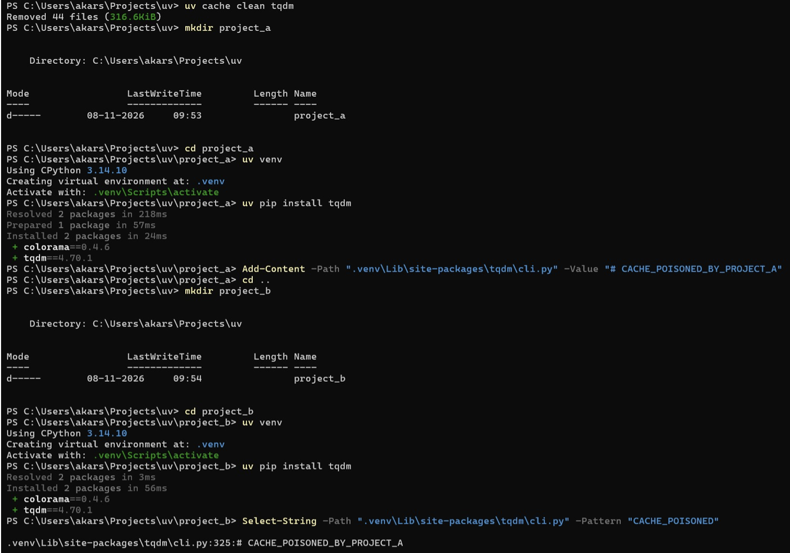

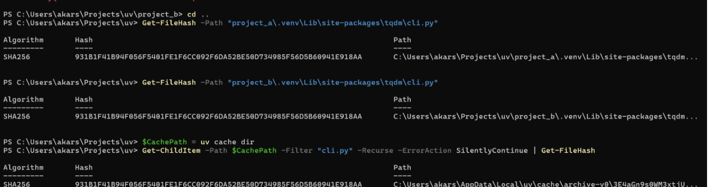

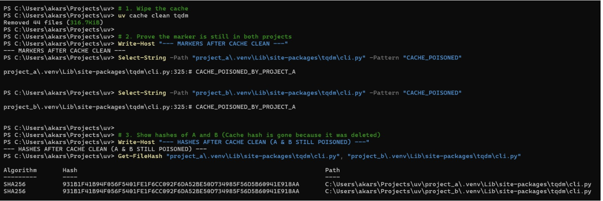

### 4.3 Comparing file hashes

The team compared the SHA-256 hashes of `cli.py` in Project A, Project B and the matching file in uv's cache.

**Observation:** The three hashes matched in the captured experiment. This is consistent with all three paths exposing the same modified file contents.

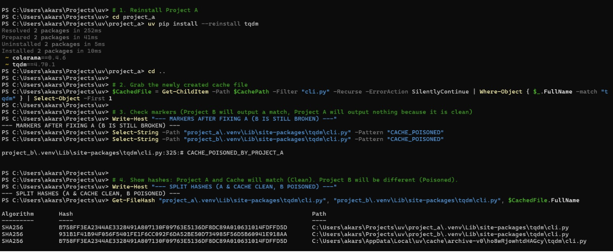

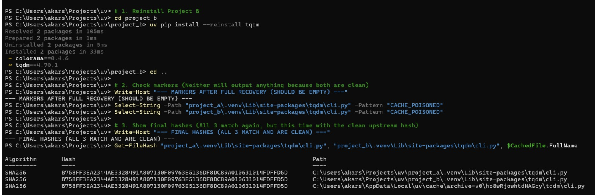

### 4.4 Cache-cleaning experiment

The team ran `uv cache clean tqdm`, then searched both environments for the marker and compared their hashes again.

**Observation:** The cache-clean command removed cached files, but the marker remained in both existing environments. Their hashes still matched.

This shows why cache invalidation and environment repair must be treated as separate operations.

### 4.5 Manual recovery experiment

**Step A — Reinstall Project A only**

```bash
cd project_a
uv pip install --reinstall tqdm
```

After reinstalling Project A:
- Project A no longer contained the marker.
- Project B still contained the marker.
- Project A and the newly created cache file had the same clean hash.
- Project B retained the old, different hash.

**Step B — Reinstall Project B**

```bash
cd project_b
uv pip install --reinstall tqdm
```

After reinstalling Project B:
- Neither environment contained the marker.
- Project A, Project B and the cache file had matching hashes again in this experiment.

Hash summary from the captured experiment (first characters of each SHA-256):

| Step | `project_a` | `project_b` | Cache file |
|---|---|---|---|
| After tampering in A | `931B1F41…` (marker) | `931B1F41…` (marker) | `931B1F41…` |
| After `uv cache clean tqdm` | `931B1F41…` (marker) | `931B1F41…` (marker) | removed |
| After reinstalling A | `B758FF3E…` (clean) | `931B1F41…` (marker) | `B758FF3E…` |
| After reinstalling B | `B758FF3E…` | `B758FF3E…` | `B758FF3E…` |

### 4.6 Round 1 conclusion

The issue was successfully reproduced. A modification made through Project A was visible in Project B. Cleaning the cache alone did not repair existing environments, and each environment retaining the modified hardlink needed to be repaired separately in the tested setup.

---

# Round 2 — Understanding the Code and Solution Design

## 5. How the Relevant Code Works Today

**Linking files into an environment.** When uv installs a wheel it unpacks it once into the global cache (the `archive-v0` folder; see `Cache::archive` in [`crates/uv-cache/src/lib.rs`](https://github.com/astral-sh/uv/blob/main/crates/uv-cache/src/lib.rs)). It then links those files into the environment's `site-packages` according to the link mode (hardlink, clone, copy or symlink). The CLI option is defined in [`crates/uv-cli/src/lib.rs`](https://github.com/astral-sh/uv/blob/main/crates/uv-cli/src/lib.rs) and the linking code lives in [`crates/uv-install-wheel`](https://github.com/astral-sh/uv/tree/main/crates/uv-install-wheel/src). With a hardlink, a write through any path changes all of them.

**Deciding what to install.** [`crates/uv-installer/src/plan.rs`](https://github.com/astral-sh/uv/blob/main/crates/uv-installer/src/plan.rs) (`Planner::build`) goes through each requirement. If a matching package is already installed it calls `RequirementSatisfaction::check` in [`crates/uv-installer/src/satisfies.rs`](https://github.com/astral-sh/uv/blob/main/crates/uv-installer/src/satisfies.rs). That function compares the installed package's version, source and build settings, and returns `Mismatch`, `Satisfied`, `OutOfDate` or `CacheInvalid`. If the answer is `Satisfied` the package is skipped; only otherwise does the planner look in the cache or download. [`crates/uv-installer/src/site_packages.rs`](https://github.com/astral-sh/uv/blob/main/crates/uv-installer/src/site_packages.rs) calls the same function in two more places (the "already satisfied" shortcut used by `uv pip install`).

**The `RECORD` file.** [`crates/uv-install-wheel/src/wheel.rs`](https://github.com/astral-sh/uv/blob/main/crates/uv-install-wheel/src/wheel.rs) writes a `RECORD` file when a wheel is installed. Each line holds a path, a hash in the form `sha256=<base64url>` and a size, and `read_record()` parses it. [`record.rs`](https://github.com/astral-sh/uv/blob/main/crates/uv-install-wheel/src/record.rs) defines `RecordEntry { path, hash, size }`. Before our change the `size` field carried `#[allow(dead_code)]` because nothing used it.

## 6. Where the Problem Comes From

- "Satisfied" is decided from metadata only. Nothing looks at file contents.
- uv assumes the cache is immutable and that installed files are what it installed. Hardlinks break that assumption, because the environment's file *is* the cache file.
- Once the cache copy is changed, every later install links the changed file, and nothing in uv removes a cache entry because it is bad.
- `RECORD` already contains what is needed to detect a change: a hash and size for each file, written at install time. `RECORD` itself is not hardlinked to the cache, so editing a package file does not change what `RECORD` says.

## 7. Choosing the Solution

The investigation showed that uv needs a way to identify when installed package files no longer match their recorded contents.

We selected **RECORD-based verification** (option 1 in the issue) for the prototype because package installations already contain `.dist-info/RECORD` metadata. This metadata provides file paths and, where available, expected hashes and sizes. It offers a way to verify installed files without introducing a separate integrity database.

## 8. Proposed Verification Flow

The intended flow is:

1. Read the installed package's `.dist-info/RECORD`.
2. For entries with usable recorded checks, compare the actual file size and hash.
3. If the checks match, the package can be considered satisfied for the files that were verified.
4. If a checked file does not match, classify the package as `Modified`.
5. Pass the modified state to warning and recovery planning.

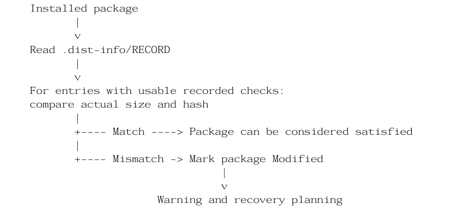

The verification should only report a confirmed mismatch when the available evidence establishes one. Missing hashes and unreadable files need distinct handling; they should not silently be treated as verified.

## 9. Solution Plan and Architecture

1. **`record.rs` (uv-install-wheel):** add a method on `RecordEntry` that checks one file on disk. Skip entries with no hash. Compare the size first as a cheap early exit, then compute the SHA-256 and compare it to the recorded hash. A missing file is a mismatch. A file that cannot be read is not flagged; only a proven mismatch counts.
2. **`satisfies.rs` (uv-installer):** add a new result, `RequirementSatisfaction::Modified`, and a `verify` flag on `check()`. Just before returning `Satisfied`, if `verify` is on, read the package's `RECORD`, check every file and return `Modified` on any mismatch.
3. **`plan.rs` (uv-installer):** handle `Modified`. Warn the user, remove the package's entry from the cache with `Cache::remove`, and queue a reinstall. Removing the cache entry is required: in hardlink mode the cache copy is the same modified file, so reinstalling from it would restore the problem.
4. **`site_packages.rs` (uv-installer):** the two other callers of `check()` pass `verify = false` and treat `Modified` as unsatisfied. The compiler requires this because the `match` has to cover every variant.
5. **Opt-in flag:** a `--verify` flag in `uv-cli`, passed through settings into the planner, so only the sync path opts in and every other caller keeps today's behaviour.
6. **Tests and documentation:** integration tests in `crates/uv/tests/it` and a note in the cache documentation.

**How this fits the existing architecture.** No new crate and no new dependency are needed (`sha2`, `data-encoding` and `fs-err` are already used by `uv-install-wheel`). The check sits at the single place where uv already decides whether an installed package is fine, and the repair reuses the existing cache-removal and reinstall machinery.

## 10. Alternatives Considered

| Alternative | Why we did not choose it |
|---|---|
| Manual cache cleanup | Requires manual intervention, does not identify modified files, and (see section 3) does not repair existing environments. |
| Reinstall all packages | Could restore original contents but causes unnecessary downloads and installs when most packages are unaffected. |
| Documentation only (issue option 3) | Does not fix the problem. We would still add a documentation note. |
| Separate `uv cache verify` command (issue option 2) | More command-line surface, and it does not repair inside the normal sync flow. Could be a follow-up. |
| Verify on every sync by default | Hashing every file of every package would slow uv down. It has to be opt-in. |
| Switch the default link mode to copy | Removes the bug but loses the speed and disk savings of hardlinks. Users who need isolation can already use `--link-mode=copy`. |
| Check file size only | Cannot detect an edit that keeps the same size. Size is only a fast first filter; the hash decides. |
| **RECORD-based verification (chosen)** | Uses metadata that is already present, so no separate integrity database is needed. |

## 11. Design Decisions and Trade-offs

### 11.1 Compare size before hashing

File size is relatively inexpensive to check, so the prototype compares it before calculating the file hash when size information is available. A matching size does not prove that file contents are unchanged; hash verification is still necessary to catch same-size edits.

### 11.2 Introduce a separate `Modified` state

A package can have the expected version installed while its files have been changed. We therefore introduced a separate `Modified` outcome rather than treating the package as simply satisfied or outdated.

### 11.3 Invalidate affected cache content

If a cached file has been modified, reusing it during reinstallation could reproduce the same problem. The implemented path therefore invalidates the affected cache entry before planning reinstallation.

### 11.4 Consider verification overhead

Reading and hashing installed files introduces filesystem and processing overhead. An opt-in verification mechanism would let users choose when to perform the additional check.

### 11.5 Open design questions

- Flag name, and whether verification should ever be on by default.
- Whether the check should only report, with a separate action doing the overwrite, since an intentional edit to an installed file would otherwise be overwritten.
- Removing the cache entry only when the cache copy is itself corrupted. Currently it is removed by package name.

## 12. How the Four Rust Files Fit Together

| File | Responsibility in the prototype |
|---|---|
| `record.rs` (`uv-install-wheel`) | Adds `matches_file` to compare an installed file with available RECORD size/hash information. |
| `satisfies.rs` (`uv-installer`) | Adds the `Modified` outcome so a package with changed files is not incorrectly classified as satisfied. |
| `plan.rs` (`uv-installer`) | Handles `Modified` in package planning, including a warning, cache invalidation and reinstall planning in the implemented path. |
| `site_packages.rs` (`uv-installer`) | Updates other satisfaction call sites to handle the new `Modified` state consistently. |

In short: **`record.rs` verifies; `satisfies.rs` classifies; `plan.rs` decides; `site_packages.rs` integrates the new state into other package-management paths.**

### 12.1 `record.rs` — Verify

The implementation adds a `matches_file` helper. At a high level, it:
- Reads expected size and hash information from the RECORD entry (entries without a hash are skipped).
- Compares file size first when available.
- Calculates SHA-256 using the same representation uv uses when writing the RECORD hash (`sha256=` followed by URL-safe base64 without padding).
- Compares the actual hash with the recorded hash.

A size match alone does not establish integrity; hash comparison is needed to detect same-size content changes.

### 12.2 `satisfies.rs` — Classify

The package-satisfaction logic gains a fifth outcome: `Modified`. When verification is enabled, the implementation checks package files before returning `Satisfied`. If a checked file does not match its recorded hash, the package is classified as `Modified`. A file that cannot be read is not treated as modified.

### 12.3 `plan.rs` — Plan a response

The planner handles the `Modified` state by removing the affected cache entry, warning that installed files do not match RECORD, and adding the package to the reinstall plan in the implemented path. In `uv pip sync` the resolver can return the already-installed distribution, in which case the planner warns and asks the user to run with `--reinstall-package`.

### 12.4 `site_packages.rs` — Integrate

Other code paths also call the package-satisfaction logic, so they must handle the new `Modified` outcome. The prototype updates those call sites and passes `false` for verification at two of them. This integrates the new state but does not mean verification is enabled across every package-management path.

## 13. Testing and Validation Plan

**Baseline:** the original two-environment reproduction from Round 1.

1. Create two virtual environments sharing the same package cache.
2. Install the same package in both environments.
3. Modify a package file in the first environment.
4. Run the implemented verification mechanism.
5. Check whether the modified package is identified.
6. Verify that the affected cache entry is invalidated.
7. Reinstall the package and check whether tampered content is removed from the repaired environment.

**Automated tests planned** (`crates/uv/tests/it`, snapshot style):
- Install a package, modify a file, sync with the flag and check the warning and repair.
- Two environments sharing a cache: after repair, a newly created environment must receive the clean file.
- Without the flag, behaviour and output must be exactly unchanged.

**Unit tests planned for the RECORD check:** matching file; modified file with the **same size** (must still be caught by the hash); modified file with a different size; missing file; entry with no hash (skipped); unreadable file (not flagged).

**Edge cases:** files uv rewrites at install time (console scripts), large packages (measure the cost of hashing), other link modes, intentional edits.

**Regression checks:** the repository test suite, `cargo fmt` and `cargo clippy` on the fork's CI.

**The original issue counts as resolved when** after the repair the SHA-256 of both environment files and the cache file equal the clean upstream hash and the marker is nowhere.

---

# Round 3 — Implementation, Testing and Results

## 14. Implementation Overview

Following the design developed in Round 2, we implemented a prototype of RECORD-based package-integrity verification in uv. The prototype checks installed package files against the integrity information available in their `.dist-info/RECORD` metadata. When a checked file does not match its recorded information, the package is classified as `Modified` and handled by the package-planning logic: a warning is shown, the affected cache entry is removed and a reinstall can then fetch a clean copy.

The implementation spans the four Rust files described in Round 2: `record.rs`, `satisfies.rs`, `plan.rs` and `site_packages.rs`.

## 15. Implementation Testing and Experimental Setup

The implementation experiment was conducted in Windows PowerShell using two virtual environments that shared uv's package cache, with a locally built uv binary.

| Parameter | Implementation test setup |
|---|---|
| Operating system | Windows (PowerShell) |
| uv version | 0.13.7 (development build) |
| Python version | 3.14.10 |
| Package in implementation test | `tqdm==4.70.1` (with its dependency `colorama==0.4.6`) |
| Virtual environments | `project_a` and `project_b` |
| Cache | Shared uv cache |
| Link behaviour | Hardlink (the Windows default) |

An earlier, smaller trial of the first prototype used the package `six` with two environments. It is described under "Failures and Roadblocks" below.

## 16. Implementation Workflow and Evidence

The implementation experiment followed this sequence:

1. Start with a clean cache and create `project_a` with its virtual environment.
2. Install `tqdm` in Project A.
3. Create `project_b` and install the same version using the shared cache.
4. Append a tampering marker to `tqdm/cli.py` in Project A.
5. Inspect the corresponding file and compare its hash across the environments and the cache.
6. Run the implemented verification path through the package synchronization workflow (`uv pip sync`).
7. Observe the RECORD mismatch warning and cache invalidation.
8. Run the explicit reinstall command when prompted, then inspect both environments again.

### 16.1 Terminal setup and package installation

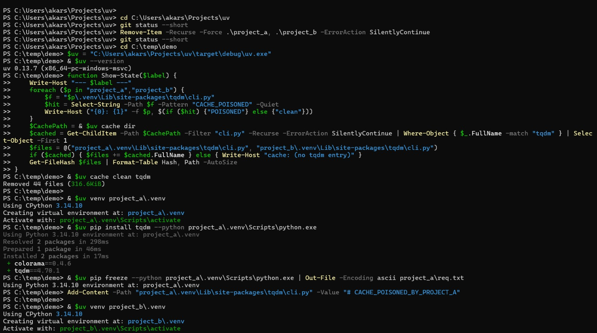

### 16.2 Tampering marker and file-hash comparison

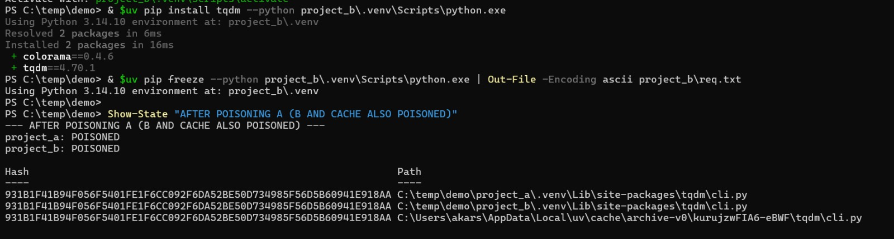

### 16.3 Verification output and cache invalidation

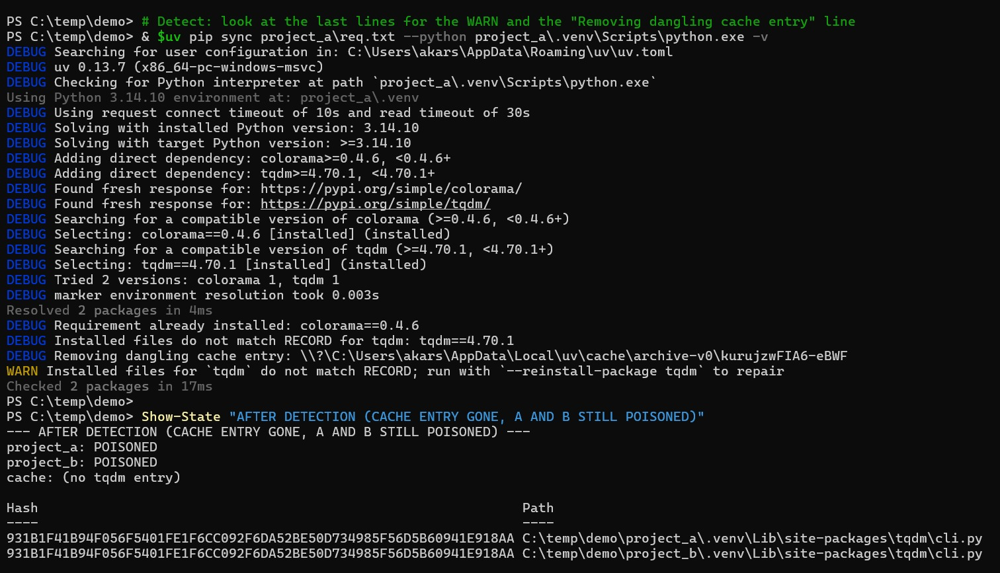

### 16.4 Reinstallation and inspection

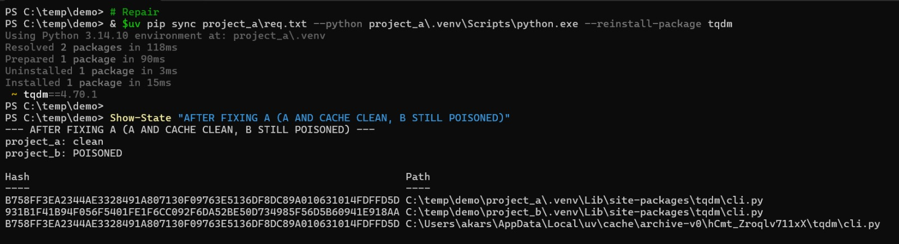

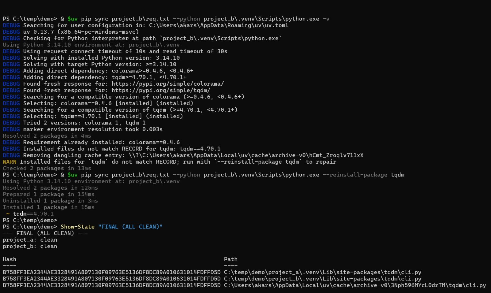

## 17. Detection Results

The verification run reported that the installed package files did not match RECORD. The warning identified `tqdm` and recommended reinstalling it. The terminal also showed cache invalidation.

The observed terminal messages included:

```text
DEBUG Installed files do not match RECORD for tqdm: tqdm==4.70.1
DEBUG Removing dangling cache entry: ...\uv\cache\archive-v0\<entry>
WARN  Installed files for `tqdm` do not match RECORD; run with `--reinstall-package tqdm` to repair
```

After detection, the state check reported that no `tqdm` entry remained in the cache, while `project_a` and `project_b` were both still poisoned with identical hashes.

This confirms that the tested verification path detected the mismatch and cleared the corrupted cache entry. It does not mean that the initial sync command completed the repair automatically.

## 18. Recovery Experiment

The recovery experiment showed why cache invalidation and environment repair are separate operations.

After the cache entry was removed, the tampering marker remained in the existing environments because their virtual-environment paths still referred to the modified hardlinked file.

We then repaired `tqdm` in `project_a` only, using `--reinstall-package tqdm`. The reinstall performed a real download (`Prepared 1 package in 90ms`):
- Project A became clean.
- Project B still contained the marker and retained the old hash.

Next, we ran detection and repair for `project_b` (`Prepared 1 package in 154ms`):
- Neither environment contained the marker.
- The hashes for Project A, Project B and the cache file matched again in this experiment.

| State | `project_a` | `project_b` | Cache file |
|---|---|---|---|
| After detection | poisoned, `931B1F41…` | poisoned, `931B1F41…` | no `tqdm` entry |
| After fixing A | clean, `B758FF3E…` | poisoned, `931B1F41…` | clean, `B758FF3E…` |
| Final | clean, `B758FF3E…` | clean, `B758FF3E…` | clean, `B758FF3E…` |

These results are specific to the tested Windows setup. They demonstrate that cache invalidation alone does not repair existing environments and that each environment retaining a modified hardlink needs to be repaired separately.

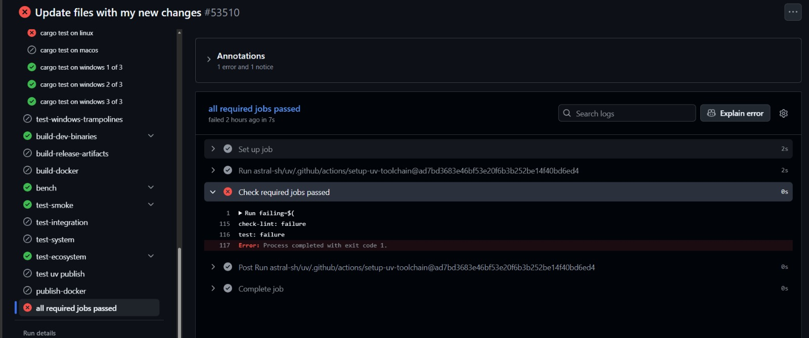

## 19. Test Results Summary

| Test | Observed result |
|---|---|
| Reproduce shared-file modification | Successful: a modification made through Project A was visible through Project B. |
| Detect modified package using RECORD | Successful: the verification path reported a mismatch. |
| Display integrity warning | Successful: the warning identified `tqdm`. |
| Invalidate affected cache entry | Successful: the terminal showed the corrupted cache entry being removed, and the later state check found no `tqdm` entry. |
| Clean cache alone repairs existing environments | No: the tampering marker remained in existing environments. |
| Reinstall Project A only | Project A became clean; Project B remained modified. |
| Reinstall Project B as well | Both environments were clean and their hashes matched the cache file in the final test. |

## 20. Continuous Integration and Build Validation

The captured GitHub Actions run on the fork showed a mixed CI result. Some checks passed, but the overall required-jobs check did not pass because test and lint jobs reported failures. The macOS Cargo test job was skipped or not executed in the captured run.

| CI check | Observed status |
|---|---|
| Cargo tests on Windows | Passed in the captured run. |
| Cargo tests on Linux | Failed: a snapshot assertion failed in `sync_git_metadata_archive_dependency`. |
| Cargo tests on macOS | Skipped / not executed in the captured run. |
| Clippy on Windows | Failed: Clippy reported disallowed `std::fs::File` usage in `record.rs`; warnings are treated as errors. |
| Clippy on Linux | Failed with the same `std::fs::File` diagnostic in `record.rs`. |
| Formatting (`fmt`) | Passed. |
| Crate and lockfile checks | Passed in the captured summary. |
| Ruff, ty, shellcheck and validate-pyproject | Passed in the captured lint summary. |

### 20.1 Clippy failure

Both the Windows and Linux Clippy logs point to the use of `std::fs::File` in `crates/uv-install-wheel/src/record.rs` (the import on line 1 and the file-opening call on line 29). uv disallows that type so that file errors carry the file path, and its CI treats warnings as errors, so these diagnostics fail the Clippy job. The same pattern is expected in the new helper in `satisfies.rs`, which Clippy had not reached yet because `uv-install-wheel` failed first.

Fix identified: use `fs_err::File` instead. Both crates already depend on `fs-err`, so no `Cargo.toml` change is needed.

### 20.2 Linux test failure

The Linux Cargo test job failed on a snapshot assertion in the existing test `sync_git_metadata_archive_dependency`. The prototype's verification call was hardcoded on, so every sync in the repository's test suite ran the RECORD check. That is the most likely cause, but the snapshot diff has not yet been inspected to confirm it.

Fix identified: switch the hardcoded verification argument in the `check` call in `plan.rs` from `true` to `false` until the real opt-in flag exists, so existing behaviour and snapshots stay unchanged.

### 20.3 CI screenshots

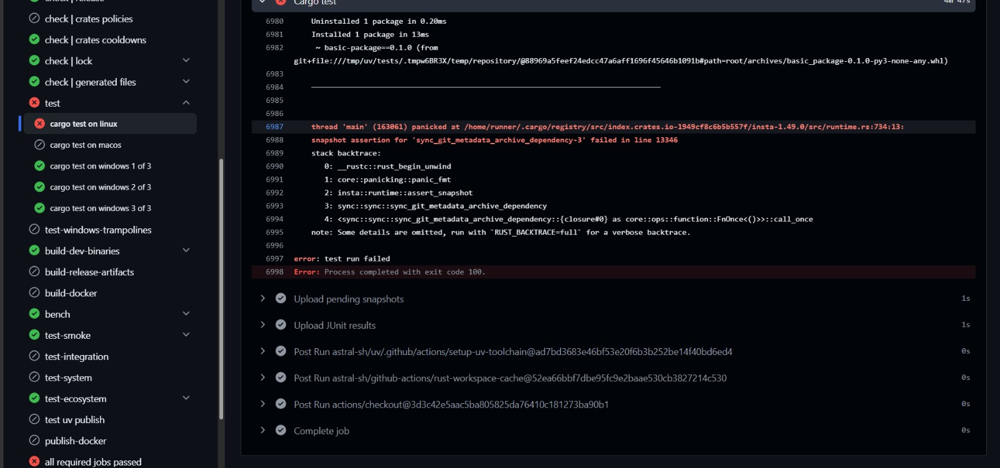

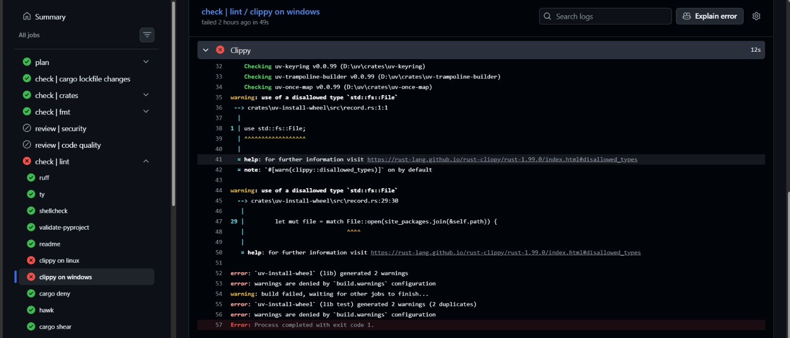

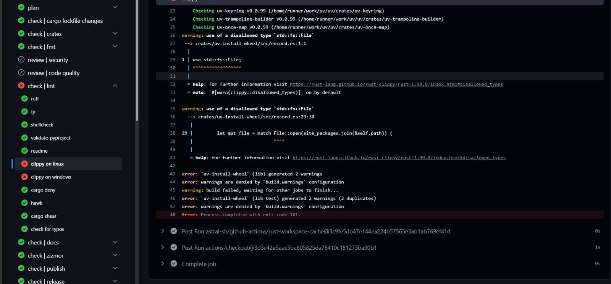

## 21. Changes from the Round 2 Plan

- The plan said verification would be opt-in. The first implementation hardcoded it on to prove the idea, and the CI run showed why it has to be off by default.
- Clippy requires `fs_err` instead of `std::fs`.
- We planned a one-command repair. In the `uv pip sync` path the resolver returns the already-installed package, so the planner cannot reinstall it directly. Repair currently takes two commands: one to detect and clear the cache entry, then a second with `--reinstall-package`.
- Cache removal is by package name. When the second environment was repaired, the cache entry created by the first repair was removed again even though it was clean. This is harmless (it only causes a re-download) but wasteful.
- `site_packages.rs` also had to be changed, because the new `Modified` result must be handled wherever `check()` is called. The compiler flagged this.
- The hash is computed with a manual read loop, because the SHA-256 hasher does not implement `io::Write`, so `io::copy` did not compile.

## 22. Current Status

**Works**
- Detection of modified installed files through `RECORD` (size and SHA-256)
- Removal of the corrupted cache entry
- Repair of each environment with `--reinstall-package`, verified on two environments sharing a cache

**In progress**
- Making verification opt-in (`--verify` through the CLI, settings and planner)
- Resolving the Clippy diagnostics and the Linux snapshot failure

**Not done yet**
- Automated integration and unit tests
- One-step repair for the `uv pip sync` path
- Removing only the corrupted cache entry instead of the whole package entry
- Testing `uv sync` in project mode, and packages that install console scripts
- Documentation, and discussing the design with the uv maintainers before any upstream pull request

## 23. How to Run

Requirements: Rust toolchain and Windows (hardlink is the default link mode there; on Linux or macOS set `UV_LINK_MODE=hardlink`).

```powershell
git clone https://github.com/Akarsh-Raju/uv
cd uv
```

If the verification argument in the `check(...)` call in `crates/uv-installer/src/plan.rs` is `false`, change it to `true` so the check runs, then build:

```powershell
cargo build
```

In a scratch folder outside the repository:

```powershell
$uv = "<path to repo>\target\debug\uv.exe"
$env:UV_LINK_MODE = "hardlink"
& $uv cache clean tqdm

# two projects, each with its own venv and tqdm
& $uv venv project_a\.venv
& $uv pip install tqdm --python project_a\.venv\Scripts\python.exe
& $uv pip freeze --python project_a\.venv\Scripts\python.exe | Out-File -Encoding ascii project_a\req.txt
Add-Content project_a\.venv\Lib\site-packages\tqdm\cli.py "# CACHE_POISONED_BY_PROJECT_A"

& $uv venv project_b\.venv
& $uv pip install tqdm --python project_b\.venv\Scripts\python.exe
& $uv pip freeze --python project_b\.venv\Scripts\python.exe | Out-File -Encoding ascii project_b\req.txt

# the marker is now in project_b as well
Select-String project_b\.venv\Lib\site-packages\tqdm\cli.py -Pattern "CACHE_POISONED"

# detect and clear the cache entry, then repair (repeat both steps for project_b)
& $uv pip sync project_a\req.txt --python project_a\.venv\Scripts\python.exe -v
& $uv pip sync project_a\req.txt --python project_a\.venv\Scripts\python.exe --reinstall-package tqdm
Select-String project_a\.venv\Lib\site-packages\tqdm\cli.py -Pattern "CACHE_POISONED"   # prints nothing
```

Expected: the first sync prints ``Installed files for `tqdm` do not match RECORD`` and `Removing dangling cache entry`, the second performs a real download, and the final search prints nothing. `Get-FileHash` on both environment files and the cache copy shows the hashes matching again.

---

# Failures and Roadblocks

| # | What went wrong | What we learned / how the plan changed |
|---|---|---|
| 1 | We first assumed hardlink was the default on Linux too. | It is the default only on Windows; macOS and Linux default to copy-on-write. We corrected the scope of the issue and our test setup. |
| 2 | `grep` does not exist in PowerShell, so our code searches failed, and shell variables such as `$uv` were lost after a restart. | Use `git grep`, and define the shell variables again at the start of every session. |
| 3 | First compile errors: the SHA-256 hasher does not implement `io::Write`, so `io::copy` failed; an import was accidentally removed; an argument was inserted inside the wrong struct; a pasted block removed two closing braces. | Use a manual read loop for hashing, make smaller edits, and let the compiler guide the fixes. |
| 4 | In the first trial with `six`, the check printed a warning but the reinstall changed nothing: the second sync was a cache hit (`Prepared 1 package in 2ms`) and the marker was still there. | In hardlink mode the cache copy is the same corrupted file, so reinstalling from it brings the problem back. In `uv pip sync` the resolver also returns the already-installed package, so the planner never re-downloads it. Plan change: remove the cache entry before reinstalling. |
| 5 | Windows Application Control (Smart App Control) blocked the freshly built, unsigned `uv.exe` and cargo's build scripts (`os error 4551`) after running `cargo clean`. | A restart fixed it. We now keep a backup copy of the working binary and avoid unnecessary clean builds. |
| 6 | Repairing the second project removed a cache entry that was already clean. | Harmless but wasteful. Planned improvement: check the cache copy against `RECORD` before deleting it. |
| 7 | We realised that an intentional edit to an installed file would be overwritten by the repair. | Verification must be opt-in, the warning must name the package, and a report-only mode is worth discussing with the maintainers. |
| 8 | The fork's CI failed on Clippy (`std::fs::File` is disallowed) and on one existing snapshot test, because the check was hardcoded on. | Use `fs_err`, and switch the check off by default until the opt-in flag exists. |

---

# What We Learned

- Hardlinks make the cache and every environment share one file, so the cache cannot be trusted to stay clean.
- `RECORD` already holds a hash and size for each installed file and is not affected when a hardlinked file is edited, which makes it a ready-made reference.
- A size comparison can only prove that a file changed, never that it is intact. The hash does the real detection and catches same-size edits.
- Detection alone is not enough. A repair also has to invalidate the cache entry, or it reinstalls the corrupted file.
- A feature that hashes every installed file cannot be on by default in a tool whose main selling point is speed. The existing test suite showed this immediately.
- Reading the existing code first kept the change small: one new check, one new result and one new branch in the planner.

---

# Conclusion

Our prototype demonstrated that RECORD-based verification can detect modified installed package files in the tested Windows setup. The verification path identified the mismatch, displayed an integrity warning and invalidated the affected cache entry.

The recovery experiment also showed that clearing the cache does not repair existing environments that still hold hardlinks to the modified file. Reinstalling Project A repaired that environment but left Project B modified. Reinstalling Project B then completed recovery in the tested setup, with both environments showing clean package contents and matching hashes.

This is evidence of successful detection and manual, environment-by-environment recovery in the tested workflow — not fully automatic repair from the initial sync command. The prototype still needs the opt-in flag, broader integration and additional validation. The Clippy diagnostics and the Linux snapshot failure also need to be resolved before the implementation can be considered CI-clean.

---

## References

- [Astral uv repository](https://github.com/astral-sh/uv)
- [Issue #22979](https://github.com/astral-sh/uv/issues/22979)
- [uv link-mode documentation](https://docs.astral.sh/uv/reference/settings/#link-mode)
- [Team working fork](https://github.com/Akarsh-Raju/uv)
